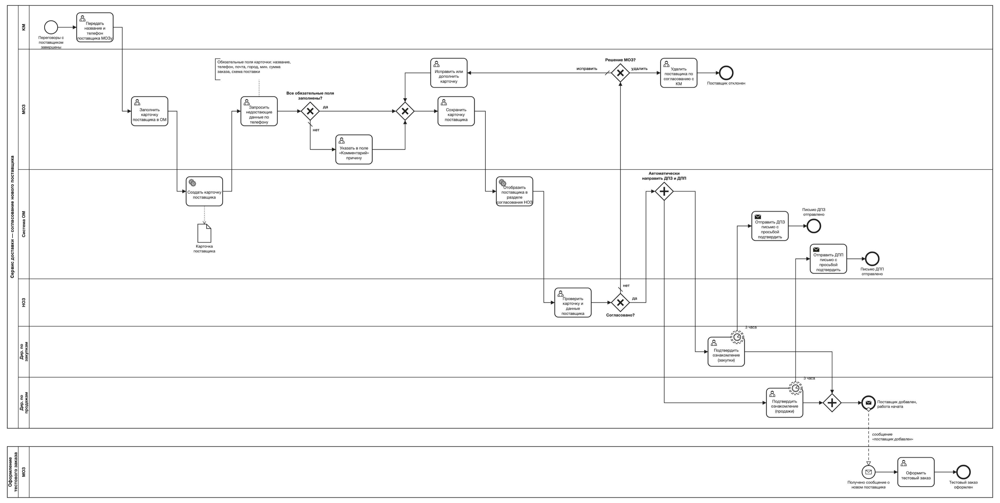
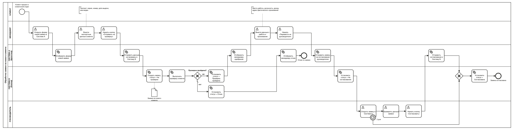
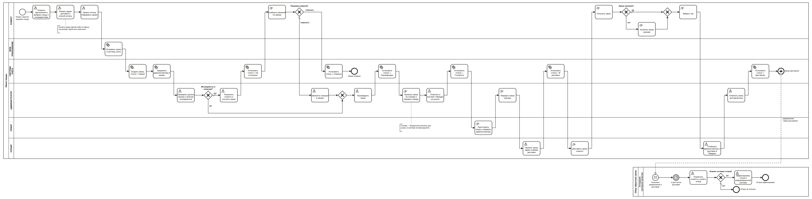
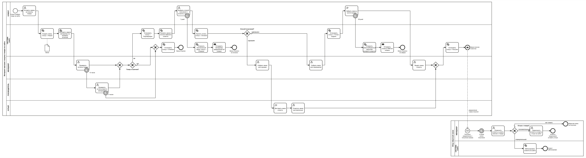

# BPMN 2.0: модели бизнес-процессов

Четыре практические задачи по моделированию процессов в нотации BPMN 2.0: смоделированные ситуации, самостоятельная работа (октябрь 2026, Storm BPMN). По трем процессам видно, как схема менялась: версия 1.0, ревью, версия 2.0.

Качество измерялось встроенной проверкой Storm BPMN: «рейтинг качества процесса» из 10 и список замечаний.

| # | Процесс | Участники | Оценка Storm | Замечаний |
|---|---|---|---|---|
| 1 | [Согласование нового поставщика](#1-согласование-нового-поставщика) | 6 ролей + процесс «Тестовый заказ» | 7,8 → **9,0** | 16 → 10 |
| 2 | [Обработка заявки на нового клиента](#2-обработка-заявки-на-нового-клиента) | клиент, менеджер, фронтенд, бэкенд, руководитель | 8,4 → **9,4** | 13 → 6 |
| 3 | [Заказ пиццы](#3-заказ-пиццы) | 6 ролей + процесс «Сбор обратной связи» | 8,4 → **9,1** | 19 → 11 |
| 4 | [Покупка товара на сайте](#4-покупка-товара-на-сайте) | клиент, сайт, менеджер, руководитель, курьер + «Сбор обратной связи» | **9,1** | 27 |

## Как устроена каждая схема

Сначала паспорт процесса, потом схема:
- **вход и выход:** с какого события процесс начинается и в каком состоянии заканчивается, включая все негативные исходы;
- **владелец и объект:** кто отвечает за процесс и что по нему движется (заказ, заявка, карточка поставщика);
- **статусная модель объекта:** статусы ставит система в задачах вида «Установить статус = …»;
- **показатели:** что измерять у процесса (срок, доля отказов, доля эскалаций по таймеру).

Правила нотации, которых держусь: старт называется фактом («Заявка получена»), конец называется состоянием результата, задача называется глаголом с объектом, развилка подписана вопросом, а ветки ответами. Тип задачи соответствует смыслу: user — действие человека в системе, manual — физическое действие, service — действие системы. Ожидание и сроки (SLA) показаны таймерами, а связь с соседним процессом — потоком сообщений между пулами.

---

## 1. Согласование нового поставщика

**Вход:** категорийный менеджер завершил переговоры с новым поставщиком. **Выход:** поставщик согласован начальником отдела закупок, оба директора подтвердили ознакомление, в процесс «Оформление тестового заказа» ушло сообщение. Другой исход: поставщик отклонен и удален. **Владелец:** начальник отдела закупок. **Объект:** карточка поставщика в системе OM.
**Показатели:** срок от передачи контактов до добавления поставщика, время согласования, доля возвратов на доработку, доля подтверждений директорами позже 3 часов, срок до тестового заказа.

**Что изменилось после ревью (1.0 → 2.0):**
- Добавлен отдельный пул «Оформление тестового заказа». Связь с ним идет потоком сообщений «поставщик добавлен», а не стрелкой внутри одного процесса.
- Подтверждение директорами разделено на две параллельные ветки (закупки и продажи). У каждой стоит таймер 3 часа и отправка письма-напоминания.
- Развилка подписана вопросом «Решение МОЗ?», для ветки «исправить» добавлена задача «Исправить или дополнить карточку». У каждого исхода свое конечное событие.
- Карточка поставщика показана объектом данных, а конечные события названы по состоянию.

[Версия 1.0](01-supplier-approval/v1.0.png) · исходники: [v1.0.bpmn](01-supplier-approval/v1.0.bpmn), [v2.0.bpmn](01-supplier-approval/v2.0.bpmn)

## 2. Обработка заявки на нового клиента

**Вход:** новый клиент пришел в клиентский отдел. **Выход:** заявка согласована руководителем, либо автоматически, если он не открыл ее за 2 дня. Другой исход: отказ по результату проверки. **Владелец:** руководитель клиентского отдела. **Объект:** заявка (хранится в Системе Б).
**Статусы:** На проверке → Отказ, либо Проверка пройдена → На согласовании → Согласована.
**Показатели:** срок от обращения до согласования, время проверки, доля отказов, доля автосогласований по таймеру.

**Что изменилось после ревью (1.0 → 2.0):**
- Роли систем разведены: Система А — фронтенд (показывает формы и результаты), Система Б — бэкенд (создает заявку, проверяет клиента, ведет статусы). В 1.0 статусы ставились в обеих системах.
- Решение «Проверка пройдена?» перенесено туда, где проверка выполняется, то есть в бэкенд.
- Добавлен таймер «2 дня» на задаче руководителя: если заявку не открыли, она согласуется автоматически, и ветки сходятся в шлюзе.

[Версия 1.0](02-request-processing/v1.0.png) · исходники: [v1.0.bpmn](02-request-processing/v1.0.bpmn), [v2.0.bpmn](02-request-processing/v2.0.bpmn)

## 3. Заказ пиццы

**Вход:** клиент открыл приложение, чтобы заказать пиццу. **Выход:** заказ доставлен и оплачен, запущен сбор обратной связи. Другой исход: заказ отменен по согласованию с клиентом. **Владелец:** администратор пиццерии. **Объект:** заказ в системе учета.
**Показатели:** срок от оформления до доставки, доля уточнений, доля отмен, доля полученных отзывов.

**Что изменилось после ревью (1.0 → 2.0):**
- Добавлен процесс «Сбор обратной связи» в отдельном пуле. Его запускает уведомление «заказ доставлен», через 2 дня после доставки сотрудник контроля качества звонит клиенту.
- Типы задач приведены к смыслу: физические действия («Получить заказ», «Забрать чек») стали manual, а не user.
- Развилки переименованы в вопросы («Заказ оплачен?», «Решение клиента?»), задачи уточнены по объекту («Принять заказ: адрес и время доставки»).

[Версия 1.0](03-pizza-order/v1.0.png) · исходники: [v1.0.bpmn](03-pizza-order/v1.0.bpmn), [v2.0.bpmn](03-pizza-order/v2.0.bpmn)

## 4. Покупка товара на сайте

**Вход:** клиент выбрал товар и оставил заявку на сайте. **Выход:** клиент получил заказ (самовывоз или курьер), запущен сбор обратной связи. Другие исходы: заказ отменен, потому что нет товара или решения руководителя, заказ не оплачен за 7 дней или не забран за 30 дней. **Владелец:** руководитель отдела продаж интернет-магазина. **Объект:** заказ на сайте.
**Показатели:** время до решения по заказу, доля эскалаций руководителю (12 ч) и автоотмен (6 ч), доля заказов, отмененных без оплаты, доля невостребованных самовывозов, срок от оплаты до получения, доля положительных отзывов.

Все сроки на схеме показаны таймерами: 12 часов на проверку остатков с эскалацией руководителю, 6 часов на решение руководителя до автоотмены, 7 дней на оплату, 30 дней на самовывоз. Сбор обратной связи запускается через 14 дней после получения.

**Что показала проверка:** самое частое замечание касалось развилок без пути «во всех остальных случаях» (default flow). Схема описывает, что делать, если товар есть и если его нет, но не говорит, что делать, если система вернула третий ответ. Это следующее, что я доработаю.

Исходник: [process.bpmn](04-online-purchase/process.bpmn)

---

## Как открыть исходники

Файлы `.bpmn` — стандартный формат BPMN 2.0 XML. Они открываются в [demo.bpmn.io](https://demo.bpmn.io) (перетащить файл в окно), в Camunda Modeler и в Storm BPMN.
